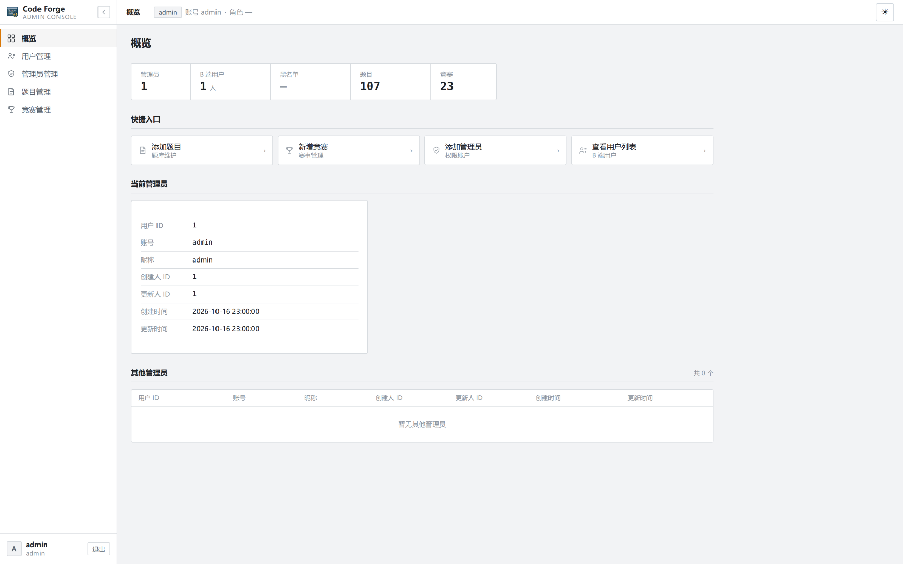
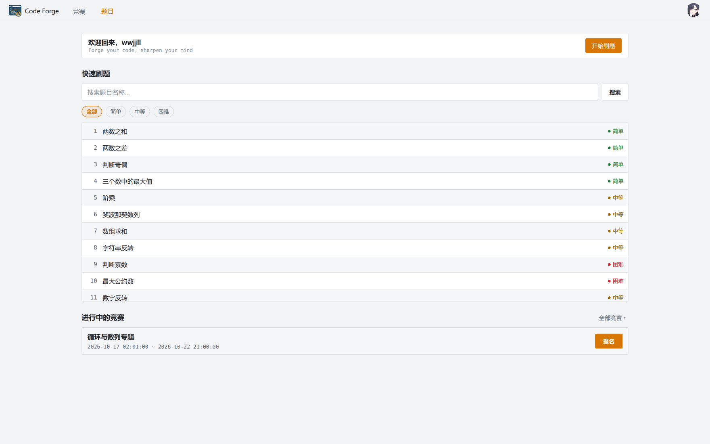
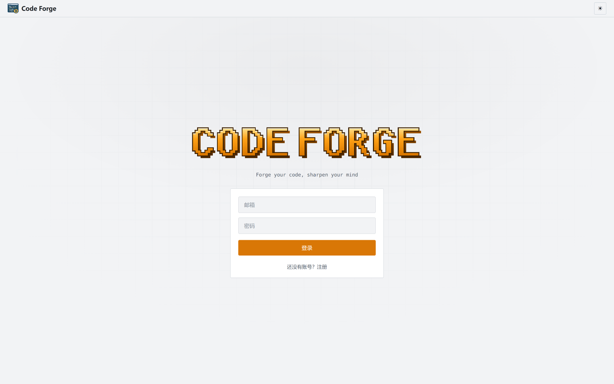
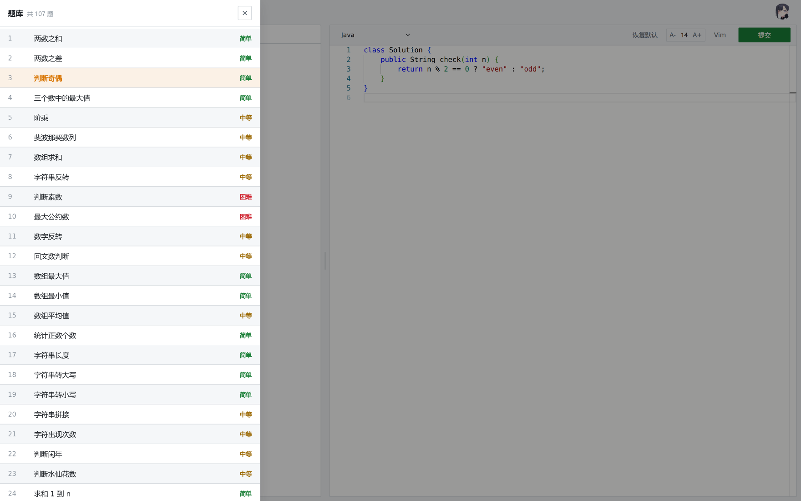
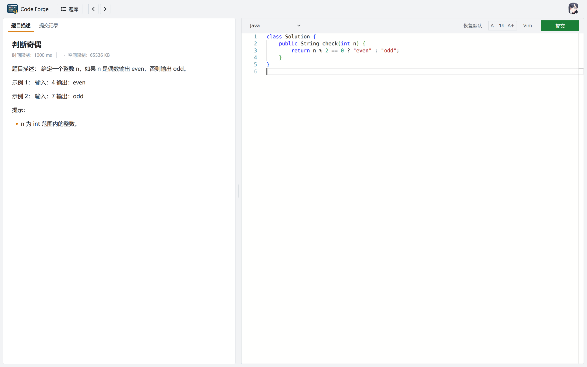
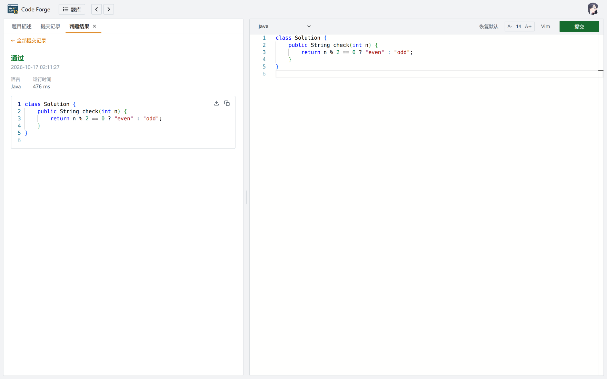
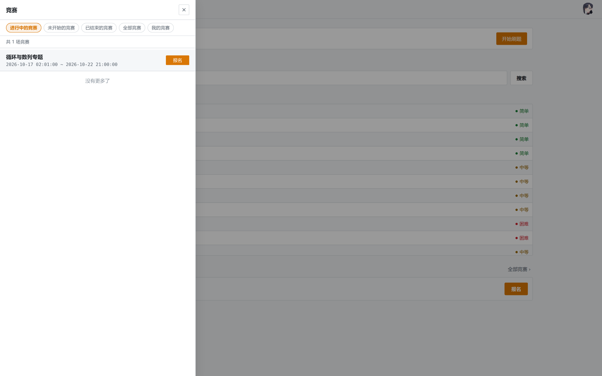
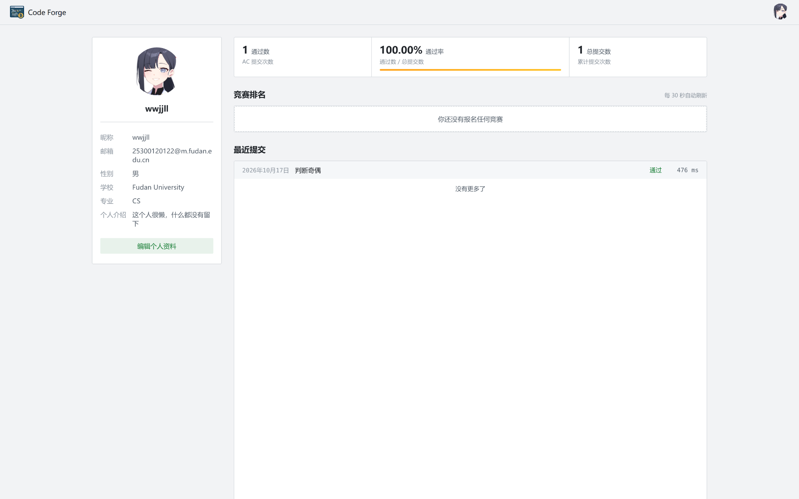

# Code Forge

<p align="center">
  
</p>
一个前后端分离的**在线判题平台（Online Judge）**：C 端面向刷题/竞赛的用户，B 端是运营与管理后台。
后端按业务拆成若干微服务，注册与配置走 Nacos，判题在独立服务里用 **Docker 容器池**执行，结果通过
RabbitMQ 回传、WebSocket 推送。

---

## 目录

- [一、B 端 · 管理后台](#一b-端--管理后台)
- [二、C 端 · 刷题与竞赛](#二c-端--刷题与竞赛)
- [三、技术栈](#三技术栈)

---

# 一、B 端 · 管理后台

独立入口 `/admin`，**独立登录、独立 token**，与 C 端互不影响：C 端用户态失效不会影响后台，后台退出也不会动 C 端登录。

>后端接口可分为三类：
>
>1. B 端用户操作，例如题目的增删改、竞赛的增删改、用户拉黑与解封操作。这些操作只有 B 端用户有权限执行
>2. C 端用户操作，例如判题、上传头像等。虽然不必禁止 B 端用户进行，但是没有支持 B 端用户操作的必要
>3. B、C 端用户共同的操作，例如竞赛列表、题目列表，这种公共信息的读操作，是双端都需要的
>
>`jwt token` 分成两套，请求路径带有 `/b/` 的，一律视为对应 1 类；没有的，全部对应 2、3 类。
>
>B、C 端 `token`，区别主要体现在自己对 `userType` 的声明：如果直接就是 C 端用户，那么就直接 `401(unauthorized)`；如果是B端用户，那么单独进行 B 端用户的校验逻辑。其他信息，比如 `userId` 是两套 token 公用的，来进行 3 类接口的鉴权。
>
>对于 2 类接口，也和 1 类接口类似


<p align="center">
  
</p>

## 概览

进入后台的首页。顶部一排统计卡（管理员数、B 端用户数、黑名单数、题目数、竞赛数），下面给出
四个快捷入口（添加题目 / 新增竞赛 / 添加管理员 / 查看用户列表），最下面是**当前管理员的信息卡**和
**其他管理员列表**——字段直接对应后端的 `SysUserVO`（用户 ID、账号、昵称、创建人/更新人 ID、创建/更新时间），

## 用户管理

- 分页拉取 B 端用户列表，支持按昵称、用户 ID 检索。
- 支持**拉黑 / 解封**：状态用「小圆点 + 文字」表示，操作成功后**只就地改这一行**，不重拉列表——否则滚动位置会丢、已加载的页要重拼。

## 管理员管理

- 管理员列表 + 新建 + 删除，支持查看某个管理员的详情弹窗。
- 新建时只需填**昵称（≤32）与密码（6–12）**，登录账号由后端生成；创建成功后会常驻展示这个账号并带复制按钮——账号是要交给对方登录后台用的，不能只弹一下提示就消失。
- 删除走二次确认；后端返回的重复昵称等错误原样透出。

## 题目管理

- 列表形态与全局约定一致：**区内无限滚动**（区域高度有上限、表头吸顶、滚到底自动追加、内容不足一屏自动补页）。
- 新增 / 编辑 / 删除题目。表单字段对齐后端 `AddQuestionDTO` 与数据库列宽（标题 ≤100、描述 ≤1000、用例 ≤1000、默认代码 ≤500……），**超限的字数计数会变红**。
- 检索：关键字走 `/question/search/filter`（关键字必填）+ 难度 chips（点一下立刻生效）；只选难度时退化为本地筛选。

## 竞赛管理

- 竞赛列表 + 新增 / 编辑 / 发布 / 取消发布 / 删除。

- **查看题目**：列出这场竞赛已有的题目（分页、区内滚动），支持把某道题移出竞赛。

- **添加题目**：点选式选择器——搜索题目、点行勾选（跨检索保留选择）、最后一次性提交；打开时会先把竞赛已有的题目 id 拉全并标成不可选，避免重复添加整批失败。

- **删除题目**：与「添加题目」同一套选择器，但**不攒批，点一行就移出一道题**，删除后就地改列表、不重拉（保住滚动位置）。

## 后台的一些共同约定

| 约定 | 说明 |
| --- | --- |
| 列表形态 | 统一「区内无限滚动」：区域高度有上限、表头 `sticky`、滚到底自动追加、内容不足一屏自动补页。终止条件优先看后端 `pages`，拿不到再用「本页是否满页」。 |
| 操作反馈 | 所有增删改的结果都用**屏幕中央的 toast**（和 C 端「已经是最后一题了」同一形态），并带**成功 / 失败标识**：成功绿勾 2.6s、失败红叉 4s、提示灰点，点一下可立刻关闭。 |
| 谁说了算 | 竞赛题目能不能增删、竞赛能不能编辑，**规则完全在后端**（详见 C 端「竞赛」一节的时间口径），前端不预判，直接把后端文案透出来。 |

---

# 二、C 端 · 刷题与竞赛

C 端是面向用户的主站：登录注册、题库、代码编辑、提交判题、竞赛报名与排名、个人中心。

## 首页

<p align="center">
  
</p>

- 顶栏：品牌、导航（竞赛 / 题目）、右侧用户菜单。
- 欢迎区：按昵称打招呼，一个「开始刷题」按钮直达编辑器。
- **快速刷题**：关键字搜索 + 难度筛选（全部 / 简单 / 中等 / 困难），列表固定高度、区内无限滚动，点击任意一行直接进编辑器。
- **进行中的竞赛**：列出当前可报名的竞赛，右侧「报名」按钮；旁边「全部竞赛 ›」打开竞赛抽屉。

## 登录 / 注册

<p align="center">
  
</p>

- 邮箱 + 密码登录；注册用邮箱验证码，**60 秒倒计时**内不能重复发送。
- 前端不存任何硬编码 token：登录拿到 token 写进 `localStorage`，统一由 `authHeaders()` 带上；未登录访问需要登录的页面会被同步守卫拦下并跳回登录页。
- 登录成功后保留原来的 `?id=` 参数，直接回到刚才那道题。

## 题库与题目详情

<p align="center">
  
</p>

- 顶栏「题库」打开**抽屉**（占屏宽 33.3%），列出序号 / 标题 / 难度，当前题目高亮。
- 列表无限分页（每页 10 条），滚动到底自动追加；越界翻页做了处理，不会出现空白页。
- 题面用 Markdown 渲染；题面里的代码块是只读的，右上角带两个图标：**复制到编辑区**、**复制到剪贴板**（仿 LeetCode）。

## 代码编辑与提交

<p align="center">
  
</p>

左右分栏（可拖拽调比例，比例会记住）：

- **左侧题面**：题目描述、时间/空间限制、示例与提示；顶部两个页签「题目描述 / 提交记录」，判题结束后会多出「判题结果」页签。
- **右侧编辑器**：Monaco Editor，支持语言选择（当前开放 Java）、字号调节（A- / A+）、**Vim 模式**、一键「恢复默认」代码。
- 顶栏有**题库**入口和**上一题 / 下一题**：走到头时不弹错误框，而是屏幕中央淡出一个灰底 toast（「已经是第一题了 / 已经是最后一题了」）。
- 提交按钮在判题期间置灰并显示「正在判题…」；前端还做了 **4 秒频控拦截**，短时间内重复点会直接提示，不必等后端返回。

## 判题结果

<p align="center">
  
</p>

- 判题是异步的：提交后由 MQ 投递到判题服务、在容器里编译执行，结果再经 MQ 回传并由 **WebSocket 推送**给页面，所以提交后先进入等待态（骨架条），结果到了自动刷新。
- 结果页给出：状态（通过 / 编译错误 / 答案错误 / 超时……）、运行时间、语言，以及提交的代码（只读代码块，同样可以复制）。
- **答案错误时会逐个展示失败用例**（输入、期望输出、实际输出）；超时用例不展示 stderr，避免输出一大堆无关信息。

## 提交记录

- 列表按时间倒序，缓存到 Redis，写缓存前先删旧 key，避免读到过期顺序。
- 点任意一条进入提交详情：状态、时间、代码与失败用例，与判题结果页共用同一套展示。

## 竞赛

<p align="center">
  
</p>

- 顶栏「竞赛」打开抽屉，五个分类：**进行中的竞赛 / 未开始的竞赛 / 已结束的竞赛 / 全部竞赛 / 我的竞赛**，按时间从后端队列接口取。
- 每条竞赛卡片显示标题、起止时间；按钮随状态变化：可报名 → 「报名」、进行中 → 「进入答题」、已结束 → 「查看」等，**能不能操作完全由后端判定**，前端不预判。
- 报名成功 / 已报名 / 失败三种结果都走统一提示。
- **竞赛答题**：从竞赛进入编辑器会带上 `examId`，非竞赛入口会主动清掉；竞赛未开始或已结束时题目锁定不可答。
- **竞赛排名**：进入竞赛后可看本场排名，后端只给「查询这一刻」的数据，前端每 30 秒轮询刷新。
- 竞赛题目的增删改由后端按**时间口径**决定，与是否发布无关：未开始可以改，进行中返回「竞赛已经开始，不能进行编辑操作」，已结束返回「竞赛已经结束不能进行操作」。

## 个人中心

<p align="center">
  
</p>

类博客的两栏布局：

- **左栏**：头像（点击可上传，走阿里云 OSS 预签名 URL，前端校验类型/大小/宽高并与后端规则对齐）、昵称、邮箱、性别、学校、专业、个人介绍，底部「编辑个人资料」。
- **右栏**：统计条（通过数、通过率、总提交数）、**竞赛排名**、**最近提交**。
- 编辑资料与上传头像成功后，顶栏与个人中心的头像会同步刷新；拿不到头像时回退到昵称首字母。

## 其它细节

- **外观**：跟随系统 / 浅色 / 深色三选一，收在头像菜单的二级菜单里；`index.html` 里有一段内联脚本在首屏就设好主题，避免亮暗闪烁。
- **偏好持久化**：主题、编辑器字号、缩放、分栏比例、Vim 模式等都存在 `cf:*` 系列 key 里，刷新后保持。
- **判题容器池**：判题服务常驻 4 个容器循环复用（带健康检查与就绪标记），临时容器用唯一名字避免冲突，容器挂了会自动重建，减少每次判题拉起容器的开销。
- **信息缓存**：对于题目列表、题目信息、竞赛列表、竞赛信息这类读多写少的操作，全部在 Redis 中进行缓存，减轻 DB 压力
- **定时任务与启动任务**：ES 数据需要从 MySQL 导入，否则将丧失检索速度优势；竞赛的状态也要在服务器维护（以服务器时间为准），启动时执行一次（生成状态缓存），每夜十二点执行一次；竞赛排名处理相同，和封榜、竞赛排名持久化结合在一起

---

# 三、技术栈

## 前端

| 项 | 选型 |
| --- | --- |
| 框架 | React 18.3 + Vite 5 |
| 编辑器 | Monaco Editor 0.52（`@monaco-editor/react`）+ monaco-vim（Vim 模式） |
| Markdown | markdown-it（题面渲染） |
| 样式 | 纯 CSS 变量 + 手写样式表（`theme.css` 全站主题、`admin.css` 后台专用），**没有引入任何 UI 组件库** |
| 工程取向 | **不引路由库、不引状态管理库、不引 Tailwind**：页面切换靠 URL query（`?id=` / `?page=` / `?tab=` / `/admin`）+ 自写同步守卫，状态用 hooks 与模块级小 store（头像、toast、我的竞赛） |

## 后端

| 项 | 选型 |
| --- | --- |
| 语言 / 运行时 | Java 17 |
| 框架 | Spring Boot 3.0.1、Spring Cloud 2022.0.0、Spring Cloud Alibaba 2022.0.0.0-RC2 |
| 注册与配置 | Nacos 2.2.2（服务注册 + 配置中心） |
| 网关 | Spring Cloud Gateway（统一入口、鉴权过滤器、CORS、白名单） |
| 持久层 | MyBatis-Plus 3.5.5 |
| 其它 | Lombok、Spring WebSocket、Spring AMQP、Spring Data Elasticsearch |

### 服务划分

| 模块 | 端口 | 职责 |
| --- | --- | --- |
| `code-forge-gateway` | 18080 | 统一入口：路由转发、token 鉴权、CORS、白名单 |
| `code-forge-system` | 18083 | 题库与竞赛的后台能力、B 端（管理员 / 用户管理）、竞赛定时任务 |
| `code-forge-friend` | 18081 | C 端用户、登录注册、题库检索（ES）、竞赛报名、提交记录 |
| `code-forge-job` | 18082 | 提交落库、判题结果回收、WebSocket 结果推送 |
| `code-forge-judge` | 18084 | 判题执行（Docker 容器池）、判题消息消费 |
| `code-forge-api` / `code-forge-common-*` | — | 公共领域模型，以及 Redis / JWT 安全 / RabbitMQ / Docker / ES / OSS 等公共组件 |

网关路由（摘）：`/system/**`、`/question/**`、`/exam/**`、`/user/b/**` → system；`/user/**`、`/user/exam/**`、`/question/search/**` → friend；`/job/**` → job。

## 中间件与外部依赖

| 组件 | 版本 / 说明 |
| --- | --- |
| MySQL | 8.4.2（业务数据，7 张表：用户、管理员、题目、竞赛、竞赛题目、报名、提交） |
| Redis | 7.0.15（题目 / 竞赛分页缓存、按时间分桶的竞赛列表、竞赛排名 ZSET、提交详情、提交频控 `interval:user:{uid}`） |
| RabbitMQ | 3.12-management（判题任务下发 / 结果回收两条队列） |
| Elasticsearch + Kibana | 8.5.3（题目全文检索，C 端搜索走 `/question/search/**`） |
| Nacos | 2.2.2（注册中心 + 配置中心） |
| 阿里云 OSS | 头像上传（后端签发预签名 URL，前端直传） |
| Docker | 判题隔离执行，使用 `eclipse-temurin:17-jdk-jammy`（Java，当前开放）；`gcc:13-bookworm` 已备好 |

## 关键链路

```
用户提交代码
   │  HTTP  POST /job/java/submit
   ▼
code-forge-job ──落库──▶ MySQL(tb_user_submit)
   │  RabbitMQ：判题任务
   ▼
code-forge-judge ──▶ Docker 容器池（编译 + 逐用例执行，取时间 / 内存）
   │  RabbitMQ：判题结果
   ▼
code-forge-job ──回写状态──▶ MySQL + Redis
   │  WebSocket（18082）
   ▼
C 端页面自动刷新出判题结果
```

部署脚本与数据库初始化脚本在 `deploy/` 目录（中间件 `docker compose`、Nacos 配置、建表 SQL）。
