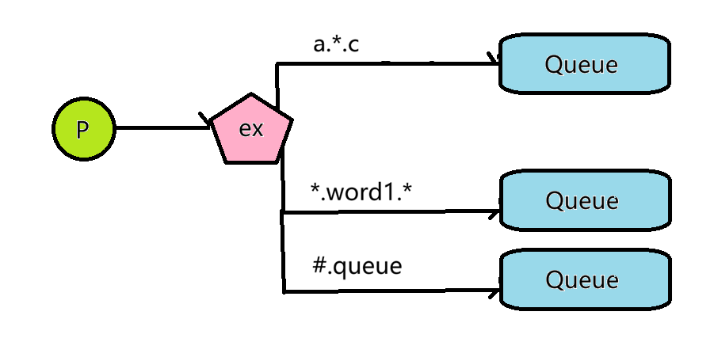

# 一、快速开始

- Docker 部署

    ```Shell
    sudo docker run -itd --name=rabbitmq_service -p5672:5672 -p15672:15672 -e RABBITMQ_DEFAULT_USER=admin -e RABBITMQ_DEFAULT_PASS=123 rabbitmq:3-management
    ```

- Web 管理界面 `http://localhost:15672`

# 二、七种工作模型

## 2.1 Simple


**Simple**，一个生产者、一个消费者，只留一个队列作为交易场所。是最简单的工作模式，点对点

## 2.2 WorkQueue


**WorkQueue**，相比于 Simple，引入了更多竞争关系的消费者，RabbitMQ 会将任务分发给其中一个消费者，常用的场景是微服务中，一个节点将请求放到队列中，请求处理集群出一个节点处理任务

## 2.3 Publish/Subscribe


`ex` 指的是交换机，生产者将数据发送到交换机后，交换机会将消息转发到队列。

交换机常用的工作模式包括

- `fanout`，直接将消息转发到所有绑定到交换机的队列，对应 `Publish/Subscribe` 模式
- `direct`，将消息根据路由键 `Routing Key` 转发到指定队列
- `topic`，将消息根据路由键（含有通配符 `*` 或者 `.`），路由到符合通配符的队列

## 2.4 Routing


根据路由键，将消息转发到指定队列，对应的交换机工作模式为 `direct`

## 2.5 Topic



根据统配规则，将消息发送到符合通配的队列，交换机工作模式为 `topic`，通配符匹配规则如下

- *`*`，匹配任意一个单词，例如  `program.language.java` 可以匹配到 `program.language.*`*
- `#`，匹配零个或多个单词，例如 `program.language.cpp` 可以匹配到 `program.#`

## 2.6 RPC 


在 RPC 模式中，没有生产者消费者（或者说都是消费者、生产者），由不同的队列将请求发送、结果返回解绑，常用于服务调用、结果接受的微服务场景，实现生产消费解绑

## 2.7 Publish/Confirm 


前面几种模式，当我们将消息发送到 RabbitMQ 时，不能确认 Rabbitmq 是否接受并且转发了消息。生产者可以通过将 Channel 设置为 confirm 模式，来进行确认：

- 对于不可路由消息，Broker 接收到消息立即返回 ACK 确认应答
- 对于可路由的消息，在完成转发到全部对应队列并且完成持久化（如果需要的话），返回 ACK
- 如果 RabbitMQ 内部错误，会返回 NACK，生产者可以选择重新发送

> 具体代码见：
> 
> - [RabbitMQ Java Client](https://gitee\.com/wangs\-joyful\-home/rabbitmq/tree/master/rabbitmq)
> 
> - [Spring AMQP](https://gitee\.com/wangs\-joyful\-home/rabbitmq/tree/master/rabbitmq\_springboot)

# 三、RabbitMQ 确认应答机制

RabbitMQ 应答机制分为两种：

- **自动应答**，Broker 发出消息就确认，不管消费者是否接收到、是否成功处理。
- **手动应答**，由消费者手动确认，在一定时间内，没有接收到确认应答，并且消费者连接断开，就重新入队发送
  
在 Spring AMQP 中，应答机制有三个选项：

1. `none`，等价于上面的**自动应答** 
2. `auto`，默认选项，只要 listener 正常完成就自动确认（Spring 完成，不需要手动调用）；如果抛出异常，那么自动否定确认
3. `manual`，手动调用，使用 `channel.basicAck()` 和 `channel.basicNack()` 两个方法

> 这里的确认应答机制，完成的是从 Broker 到消费者的可靠性确认

# 四、RabbitMQ 持久化

持久化包含三部分

- **交换机持久化**，在创建交换机时，`.durable(true)`。此时当 Broker 断电重启后，交换机依然存在，否则交换机的原信息丢失
- **队列持久化**，同样在创建队列时进行，`QueueBuilder.durable(queueName).build()`。Spring AMQP 中默认开启队列持久化
- **消息持久化**，如果没有开启队列持久化，那么当 Broker 断电重启时，队列消息丢失，持久化的消息也会丢失。消息持久化在发送消息时指定

> 即使开启了 RabbitMQ 交换机、队列、消息持久化也不代表消息能够不丢失，下面两种情况仍然会丢失消息
>
> 1. 在写入磁盘的过程中，可能中途被打断而导致消息丢失，解决方式可以是下面的发送方确认
> 2. 如果消费者设置自动应答，并且没有接收到消息或者在处理消息时异常，依然会发生丢失，这种解决方式可以是手动应答

# 五、发送方确认

RabbitMQ 确认应答机制、RabbitMQ 持久化，分别解决了消息在从 Broker 到 Consumer、在 Broker 内部的可靠性，但是在 Producer 到 Broker 以及 Broker 落盘失败的情况下呢？

RabbitMQ 提供了发送方确认机制，包含两种方式

- Confirm 确认模式
- Return 模式

## 5.1 Confirm 确认模式

不仅是消费者会给予 Broker 确认，Broker 也会在接收并成功路由消息（如果需要的话还包括落盘）之后，向 Producer 发送确认。

发送方可以设置回调函数，处理 Ack 和 NAck 的情况

Confirm 机制，解决了消息压根就没有到达 Broker 或者 Broker 出现错误无法路由消息的情况

## 5.2 Return 模式

当 Broker 无法将消息路由到任何一个消息队列时，可以选择开启 Return 机制，通过设置回调函数，接收消息路由失败的信息

在 Spring AMQP 中，使用 Confirm 确认模式和 Return 模式

- 开启消息发送确认

    ```yaml
    spring:
      rabbitmq:
        publisher-confirm-type: corrlated
    ```

- 设置回调函数

    ```java
    @Configuration
    public class RabbitTemplateConfig {
        @Bean
        public RabbitTemplate rabbitTemplate(ConnectionFactory connectionFactory) {
            RabbitTemplate rabbitTemplate = new RabbitTemplate(connectionFactory);
    
            //Confirm 模式
            rabbitTemplate.setConfirmCallback((correlationData, ack, cause) -> {
                if(ack){
                    System.out.println("Broker 成功接收消息");
                }
                else{
                    System.out.println("Broker 接收消息失败");
                }
            });
    
            //Return 模式
            rabbitTemplate.setReturnsCallback(returned -> {
                System.out.println("消息路由失败：" + returned);
            });
    
            return rabbitTemplate;
        }
    }
    ```

> 总结：
>
> 
>
> **RabbitMQ 怎样进行消息的可靠传输？** 
>
> 1. **生产者到 Broker**：使用发送方确认机制的 Confirm 模式，如果消息未能到达 Broker 或者 Broker 未能成功处理，会返回 Nack 给回调
> 2. **在交换机中没能成功路由到队列**：使用发送方确认机制的 Return 模式
> 3. **在 Broker 内部消息丢失**：开启持久化机制，包括交换机持久化、队列持久化、消息持久化
> 4. **消息未能到达消费者或消费者处理失败**：应答机制，包括自动应答和手动应答两种方式（自动应答相当于直接放弃对于消费者处理的确认）

# 六、重试机制

RabbitMQ 的重试机制由框架提供，而不是 Broker 原生提供的能力，在 Spring AMQP 中，重试次数形如下面配置

```yaml
spring:
  rabbitmq:
    retry:
      enabled: true # 是否开启重试机制
      initial-delay: 5000ms # 第一次失败延迟时间
      max-attempts: 5 # 最大重试次数
```

根据配置的确认方式（`spring:rabbitmq:acknowledge-mode: `），具体体现为：

- `none`，自动确认时，重试次数超过（包括第一次尝试），会抛出异常
- `auto`，当重试次数超过时，会通过警告的方式日志提醒，并进行自动应答，消息丢失（默认行为）
- `manual`，手动确认，取决于 `basicAck` 和 `basicNack`，不受重试次数的限制

# 七、TTL 过期时间

RabbitMQ 支持对消息设置过期时间，包含两个方面：

- 消息 TTL，在发送消息时设置；当消息过期时，不会立刻删除（懒处理），而是在将要投递到消费者时处理（每个消息的过期时间在发送时确定，各不相同，尝试确定会消耗额外的时间）
- 队列 TTL，在建立队列时确定，所有消息都会在这个时间内过期（消息 TTL 的优先级更高，但是取消息 TTL 和队列 TTL 的最小值）；当消息过期时，立即删除（在队列过期的场景下，过期的消息一定在队列头部，不需要遍历队列）

**队列过期时间**

```java
@Bean("ttl_queue")
public Queue getTtlQueue(){
    return QueueBuilder.durable(Constants.TTL_QUEUE).ttl(10*1000).build();
}
```

**消息过期时间**
```java
String ttl = "10000"; //10s
rabbitTemplate.convertAndSend(Constants.TTL_EXCHANGE, Constants.TTL_QUEUE, "testing ttl", messagePostProcesser->{
    messagePostProcesser.getMessageProperties().setExpiration(ttl);
    return messagePostProcesser;
});
```

# 八、死信队列

**死信**，Dead Letter，一般来自下面几种情况

- 到达 ttl 限制的存活时间
- 超过队列最大长度的消息会被加入死信队列
- 未能成功确认（basicNack）并且不重新入队的消息

**死信队列**就是用来存放这些信息的队列，Dead Letter Queue；用来服务死信队列的交换机就是**死信交换机**，Dead Letter Exchange。

本质上死信队列、死信交换机都是普通的队列、交换机，但是当其他普通队列产生死信并且配置了死信交换机、死信路由键时，死信会自动分发到死信队列

例如，为队列绑定死信交换机及相应路由键

```java
@Bean("nor_q")
public Queue getNormalQ(){
    //设置死信队列、死信交换机
    return QueueBuilder.durable(Constants.NORMAL_Q)
            .deadLetterExchange(Constants.DLX)
            .deadLetterRoutingKey("dlx") // 这里是告诉队列死信队列的路由键，在创建死信队列时还要进行路由键的绑定
            .build();
}
```

> 死信队列的作用
> 1. 收集应用程序无法处理的信息，方便或许分析，改进设计
> 2. 防止消息丢失，将消息重新放到队列中重试
> 3. 日志收集，将死信作为日志资源分析
> 4. 消息丢弃，直接清理资源

# 九、延迟队列

**延迟队列**，指的是消息经过一定时间后，再推送给消费者，在需要“延时”进行的服务中非常实用（例如调查问卷发送、评价推送等）。

RabbitMQ 并没有直接提供延迟队列的功能，但是可以通过 DLQ + TTL 机制手动实现，流程如下：

- 消息或队列设置 ttl
- 消息过期，成为死信，进入死信队列
- 有消费者订阅死信队列，这时死信队列就扮演了延时队列的角色

除了手动实现，RabbitMQ 可以通过插件的方式支持延时队列。如果只是有基本功能即可，那无论从稳定性、复杂度上，都建议手动实现，但是需要知道以下问题：

- 如果 TTL 实现是消息持久化，则可能会出现队头阻塞：TTL 很大的消息占着队头不走，后面已经过期的时间因为 RabbitMQ 只检查队头的机制无法成为死信，进入延时队列（死信队列）
- 如果 TTL 实现是队列持久化，没有问题，因为所有消息存活时间相同，队头的是最接近过期的时间。但是如果前面消息持久化，每个消息 TTL 相同，就等价于队列持久化的情况

# 十、事务

RabbitMQ 基于 AMQP (Advanced Message Queue) 实现，支持事务机制：在同一个事务中的消息，接收和发送都是原子的，要么全部成功，要么全部失败。

Spring Boot 中，可以通过 `Transactional` 开启事务，在 `RabbitTemplate` 开启事务机制